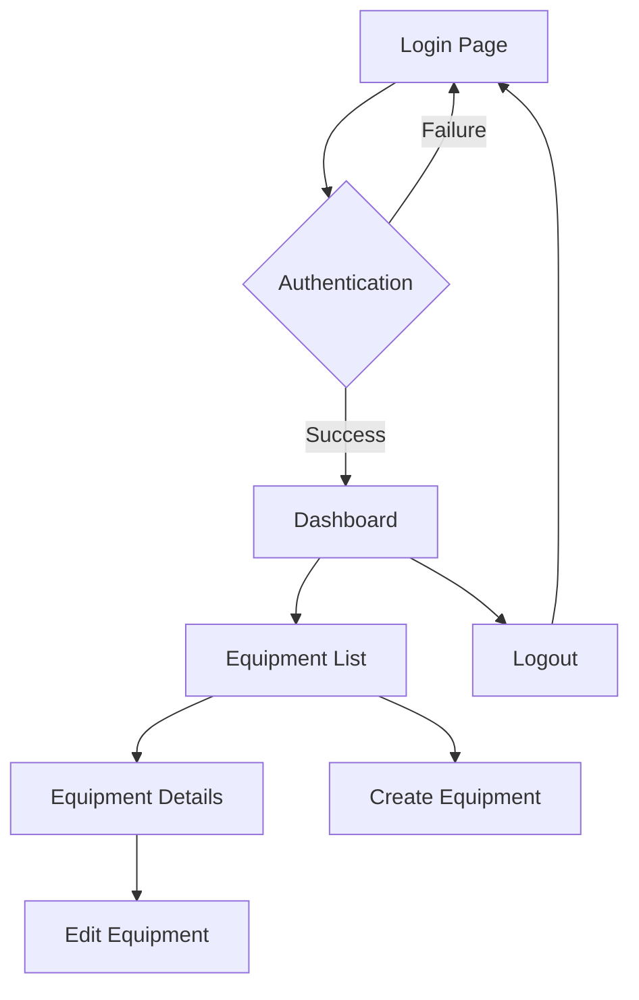

## 1. Product Overview
A React-based web application that provides authenticated access to equipment management API endpoints. Users can log in securely and interact with equipment data through a clean, responsive interface.

The application solves the problem of equipment data management by providing an intuitive frontend for API interaction, helping users efficiently browse, search, and manage equipment information through a web interface rather than direct API calls.

## 2. Core Features

### 2.1 User Roles
| Role | Registration Method | Core Permissions |
|------|---------------------|------------------|
| Authenticated User | API-based authentication | Access equipment data, view details, perform CRUD operations |
| Guest User | None (redirected to login) | Can only access login page |

### 2.2 Feature Module
Our equipment API reader application consists of the following main pages:
1. **Login page**: User authentication, credential input, error handling.
2. **Dashboard page**: Equipment overview, summary statistics, quick actions.
3. **Equipment list page**: Browse all equipment, search/filter functionality, pagination.
4. **Equipment details page**: View detailed equipment information, edit capabilities.
5. **Equipment create/edit page**: Form for adding new equipment or editing existing items.

### 2.3 Page Details
| Page Name | Module Name | Feature description |
|-----------|-------------|---------------------|
| Login page | Authentication form | Allow users to enter credentials and authenticate with the API. Include username/email and password fields with validation. |
| Login page | Error handling | Display authentication errors clearly with user-friendly messages. |
| Dashboard page | Statistics overview | Show total equipment count, active items, and recent activity summary. |
| Dashboard page | Quick actions | Provide shortcuts to most common tasks like adding new equipment. |
| Equipment list page | Search and filter | Enable users to search equipment by name, type, or status with real-time filtering. |
| Equipment list page | Data table | Display equipment in a sortable table with pagination controls. |
| Equipment list page | Action buttons | Include view, edit, and delete actions for each equipment item. |
| Equipment details page | Information display | Show all equipment attributes including ID, name, type, status, and metadata. |
| Equipment details page | Edit functionality | Allow authorized users to modify equipment details and save changes. |
| Equipment create/edit page | Form validation | Implement client-side validation for required fields and data formats. |
| Equipment create/edit page | API integration | Handle form submission and API communication for create/update operations. |

## 3. Core Process
### User Authentication Flow
1. User accesses the application and is redirected to login page if not authenticated
2. User enters credentials and submits the login form
3. Application validates credentials against the API authentication endpoint
4. On successful authentication, JWT token is stored in localStorage/sessionStorage
5. User is redirected to the dashboard page
6. All subsequent API requests include the authentication token

### Equipment Management Flow
1. Authenticated user lands on dashboard with equipment summary
2. User navigates to equipment list to browse all items
3. User can search/filter equipment based on various criteria
4. User clicks on specific equipment to view detailed information
5. User can edit equipment details or create new equipment entries
6. Changes are submitted to the API and UI updates accordingly

## 4. User Interface Design

### 4.1 Design Style
- **Primary colors**: Blue (#2196F3) for primary actions, white for backgrounds
- **Secondary colors**: Gray (#757575) for secondary text, green (#4CAF50) for success states
- **Button style**: Rounded corners (4px radius), flat design with hover effects
- **Font**: System fonts (Roboto, sans-serif) for better readability
- **Layout style**: Card-based layout with consistent spacing (8px grid system)
- **Icons**: Material Design icons for consistency and clarity

### 4.2 Page Design Overview
| Page Name | Module Name | UI Elements |
|-----------|-------------|-------------|
| Login page | Authentication form | Centered card layout with input fields, primary button, error message area. Background gradient with subtle pattern. |
| Dashboard page | Statistics overview | Grid of metric cards showing key statistics with icons and numbers. Responsive layout adapting to screen size. |
| Equipment list page | Search and filter | Top search bar with filter dropdowns, real-time search results highlighting. |
| Equipment list page | Data table | Clean table with alternating row colors, sortable headers, action buttons with icons. |
| Equipment details page | Information display | Two-column layout with equipment image placeholder and detailed information cards. |
| Equipment create/edit page | Form validation | Form with labeled input fields, validation indicators, save/cancel buttons. |

### 4.3 Responsiveness
The application follows a desktop-first design approach with mobile adaptation:
- Desktop: Full-featured layout with sidebar navigation and multi-column content
- Tablet: Simplified navigation with collapsible menu and adjusted grid layouts
- Mobile: Single-column layout with touch-optimized buttons and swipe gestures
- Touch interaction: Larger tap targets (minimum 44px), swipe actions for mobile devices

### 4.4 Loading States and Feedback
- Skeleton screens during data loading
- Toast notifications for success/error messages
- Progress indicators for long-running operations
- Disabled states for form submission buttons during API calls